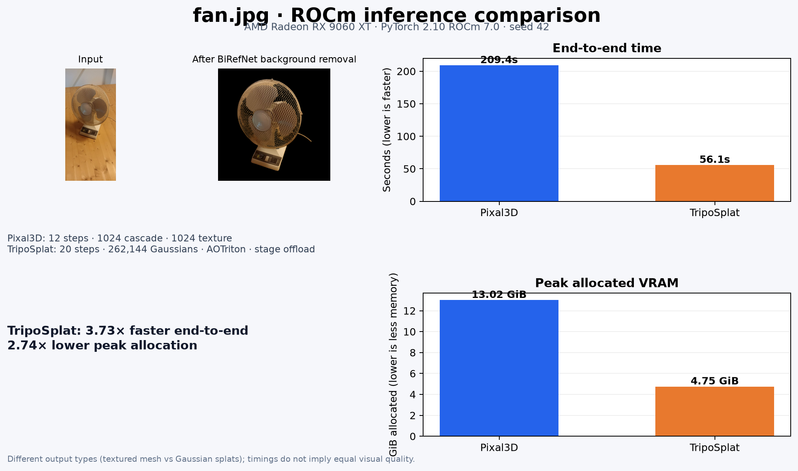

# ROCm benchmark · 2026-10-08



Same `fan.jpg` input on an AMD Radeon RX 9060 XT (gfx1200), ROCm 7.1.1, PyTorch 2.10.0+rocm7.0. Times include model loading, image preprocessing, inference, and writing the asset; import time is excluded. Peak is PyTorch allocated VRAM (`max_memory_allocated`), in GiB.

| Pipeline | End-to-end | Pipeline inference | Peak allocated | Output |
|---|---:|---:|---:|---|
| Pixal3D | 209.44s | 112.88s | 13.02 GiB | [GLB](../../Pixal3D/output/fan_benchmark_pixal3d.glb) |
| TripoSplat | 56.12s | 47.52s | 4.75 GiB | [PLY](triposplat_rocm.ply) |

Pixal3D used the existing tuned settings: 12 steps, low-VRAM mode, 1024 cascade, 49,152 max tokens, 150k mesh decimation, and 1024 texture. TripoSplat used 20 steps and 262,144 Gaussians. Its [prepared input](triposplat_preprocessed.png) shows the built-in BiRefNet background removal.

Stage offload changed TripoSplat from 55.30s / 6.41 GiB to 56.12s / 4.75 GiB (+1.49% time, 25.8% lower allocation). AOTriton-disabled attention OOMed trying to allocate 9.01 GiB with 1.23 GiB free.

A focused FP16 AOTriton-vs-math SDPA check had max absolute error 1.22e-4. The final PLY has 262,144 vertices, 17 finite float attributes, and same-seed runs produced identical PLY bytes. Output types differ (mesh vs Gaussian splats), so the comparison is runtime and memory rather than visual quality.

Detailed measurements and test conditions are in [metrics.json](metrics.json); logs are alongside it.

## TripoSplat TSDF mesh experiment

[Experimental GLB mesh](triposplat_tsdf.glb) · [Preview](triposplat_tsdf_preview.png) · [Measurements/settings](triposplat_tsdf.json)

The mesh took 3.82s to extract from the saved TripoSplat PLY. This prototype renders 14 orthographic depth maps by projecting Gaussian ellipsoids, fuses them into a 96³ weighted TSDF, and runs marching cubes. The GLB has 33,748 vertices and 67,054 faces; it is not watertight. Vertex colors are nearest-Gaussian DC colors, with no UV texture. Because the depth maps use a simple splat projection rather than TripoSplat’s calibrated renderer, regard the GLB as a visual experiment, not production geometry.

## Pixal3D timing and parameter experiments

[Detailed run data](pixal3d_investigation.json) · [12 vs 10 geometry](pixal_steps_geometry_compare.png) · [12 vs 10 textured render](pixal_steps_texture_compare.png) · [12 vs 8 render](pixal_steps_compare.png)

All inference runs used the same `fan.jpg`, seed 42, low-VRAM mode, 1024 cascade, 49,152 token setting, 150k-face target, and 1024 texture. Times are single-run measurements on the RX 9060 XT; compare differences of only a few seconds cautiously.

The optional `PIXAL_TIMING=1` instrumentation prints synchronized timings for model initialization, preprocessing, camera estimation, each conditioning/sampling stage, latent decoding, and GLB export. It is disabled by default.

The earlier comparison recorded 209.44s for Pixal3D. This fresh profiled run measured 183.86s with the same recorded settings; the old run has no component breakdown, so the 25.58s difference cannot be attributed confidently. Treat the within-batch A/B results below as the more useful comparison; each is still a single run.

| Variant | Total | Pipeline | Peak allocated | Notes |
|---|---:|---:|---:|---|
| FP16, 12 steps | 183.86s | 110.31s | 13.02 GiB | Profiled baseline; Pixal model init 53.40s |
| FP16, 10 steps | 171.41s | 96.75s | 13.02 GiB | 12.45s faster end-to-end |
| FP16, 8 steps | 159.25s | 85.04s | 13.02 GiB | 24.61s faster; visible fan detail/coherence loss |
| BF16 NAF, 12 steps | 228.17s | 151.22s | 13.02 GiB | Slower; NAF conditioning took 13.03s LR and 34.01s HR |
| FP16, conditioners resident | 184.52s | 108.45s | 13.03 GiB | No measurable end-to-end improvement |
| FP16, manual FOV 0.8217 | 177.98s | 112.15s | 13.02 GiB | Skips MoGe; saves about 5.9s in this run |

The timed MoGe load and estimate were 4.83s and 2.55s. The CLI initializes the Pixal3D pipeline on every `run_inference` call; the app initializes and retains it across requests. At the fixed 1024 cascade, the token limit cannot reduce the resolution because the code exits the limit loop at 1024. Disabling the stage cache clears caused CuMesh to run out of VRAM during GLB simplification, so that behavior remains enabled.

A 50,000-point symmetric surface comparison against the 12-step mesh measured mean nearest-surface distances of 0.004786 model units for 10 steps and 0.004918 for 8 steps. The 10-step silhouette is close in the inspection render, but its texture has a visible artifact on the base. Eight steps shows more detail/coherence loss. This is one image and one seed, not a broad quality evaluation; surface distance does not measure texture or topology defects.

## Native TRELLIS.2 baseline

`Pixal3D/inference_trellis2.py` runs the included upstream TRELLIS.2 pipeline against `microsoft/TRELLIS.2-4B` with ROCm SDPA, low-VRAM staging, and the native 12-step 1024 cascade. It writes the textured GLB, a JSON timing breakdown, and a console log. The first run includes uncached checkpoint downloads in model-load time.

```bash
cd Pixal3D
HF_HUB_DISABLE_XET=1 PYTHONUNBUFFERED=1 ../.venv/bin/python inference_trellis2.py \
  --image assets/images/fan.jpg \
  --output ../artifacts/benchmark_2026-10-08/trellis2_fan.glb
```

The successful cached run took 224.69s end-to-end (69.62s model initialization, 144.60s preprocess plus inference, 10.45s GLB export) and peaked at 4.88 GiB allocated VRAM. The first uncached model load took 2,325.77s including checkpoint downloads. Its generation and decode completed, but a runner return-value mismatch prevented export; the cached rerun fixed that and produced the linked asset. Detailed timings are in [trellis2_fan.json](trellis2_fan.json), console output in [trellis2_fan.log](trellis2_fan.log), and the output is [trellis2_fan.glb](trellis2_fan.glb).

| 12-step run | Model init | Generation | GLB export | End-to-end | Peak allocated |
|---|---:|---:|---:|---:|---:|
| Pixal3D | 53.40s | 110.31s after preprocessing | 9.51s | 183.86s | 13.02 GiB |
| TRELLIS.2 (cached) | 69.62s | 144.60s including preprocessing | 10.45s | 224.69s | 4.88 GiB |

This one-image comparison shows Trellis.2 at lower VRAM use and higher runtime. Generation timing boundaries differ as noted, and each is a single run. The exported GLB loaded as one geometry with finite bounds and is 5.41 MB.

Keeping every model resident was also tested with the GPU otherwise idle. It OOMed while moving the background-removal model after PyTorch had allocated 15.68 GiB, before inference began. The all-resident option is therefore not usable on this 16 GiB card; stage offload remains required unless the pipeline is changed to keep only selected models resident.
